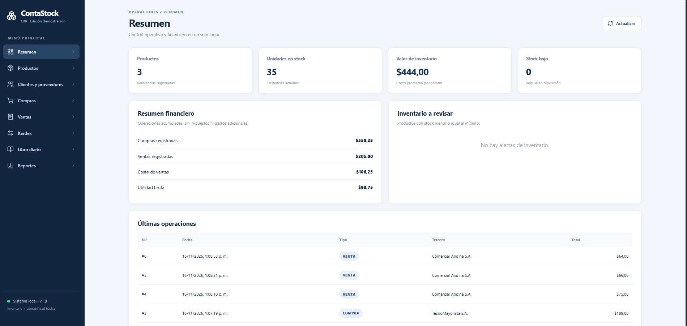
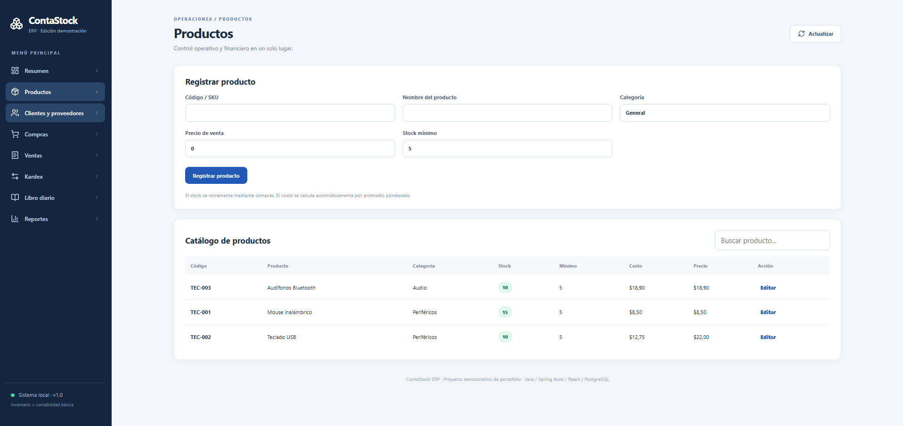
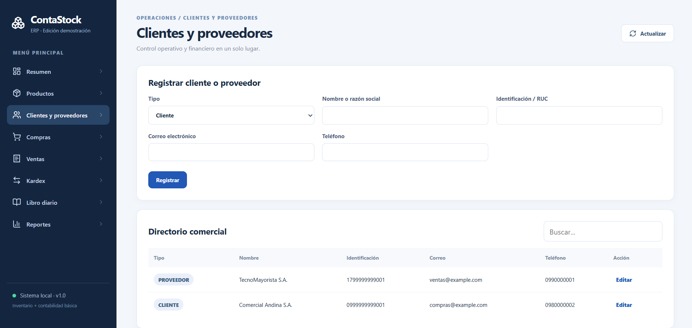
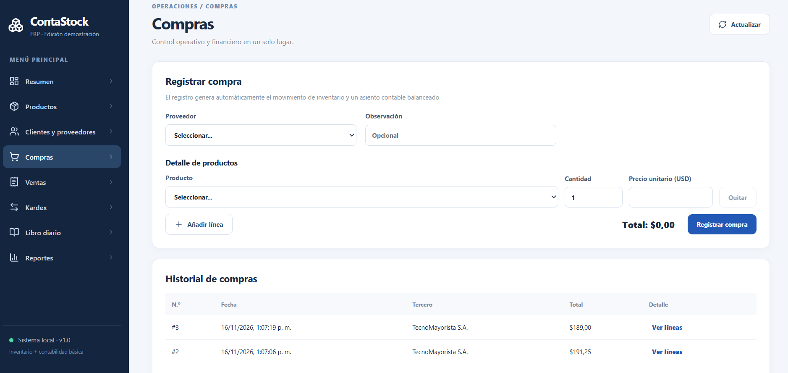
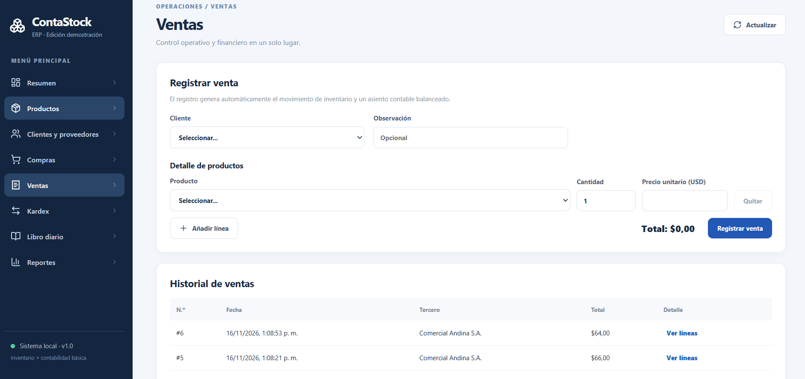
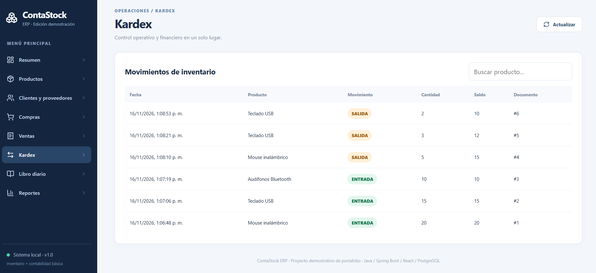
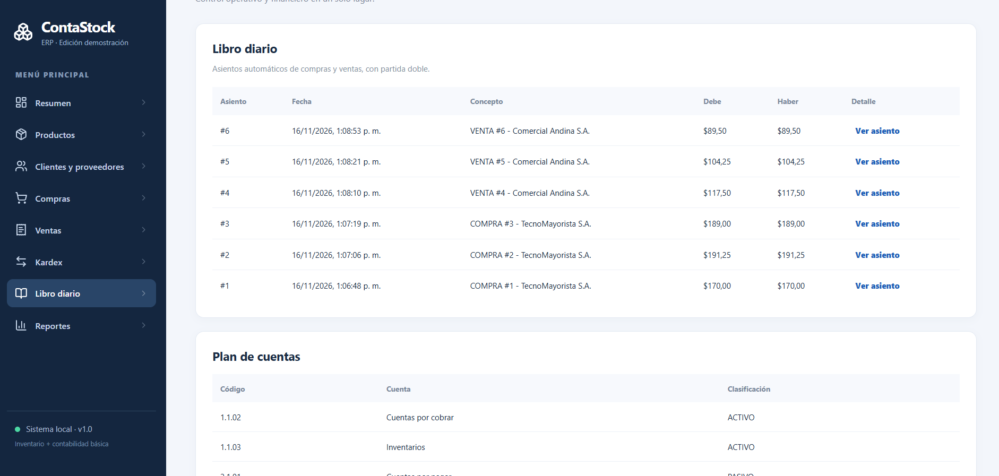
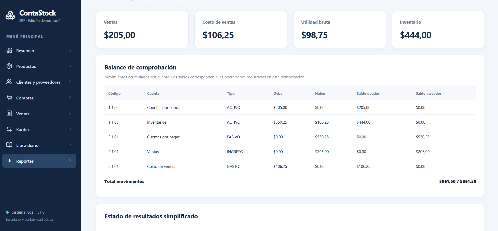

# ContaStock ERP 1.0

**Sistema demostrativo de inventario y contabilidad básica**, construido con Java 21, Spring Boot 3.5, PostgreSQL y React/Vite.

## Módulos

- Dashboard: productos, existencias, valor del inventario, compras, ventas y utilidad bruta.
- Productos: código, categoría, precio de venta, stock mínimo, edición.
- Clientes y proveedores: registro y edición.
- Compras: entradas de inventario, costo promedio ponderado y asiento contable automático.
- Ventas: salidas de inventario, control de stock, costo de ventas y asiento automático.
- Kardex: movimientos de entrada/salida y saldos.
- Libro diario: asientos y líneas de partida doble.
- Reportes: balance de comprobación y resultado bruto simplificado.

## Capturas de pantalla

Las siguientes imágenes muestran el funcionamiento local del sistema con datos ficticios.

### 1. Resumen general
Indicadores de productos, existencias, valorización de inventario y resultados.



### 2. Productos
Catálogo con SKU, categoría, stock, costo y precio.



### 3. Clientes y proveedores
Directorio de terceros comerciales y formulario de registro.



### 4. Compras
Registro e historial de compras que incrementan las existencias.



### 5. Ventas
Registro e historial de ventas que descuentan existencias.



### 6. Kardex
Trazabilidad de entradas, salidas y saldos de productos.



### 7. Libro diario
Asientos contables generados por las operaciones registradas.



### 8. Reportes contables
Balance de comprobación y resumen de resultados.



## Requisitos

- Java 21 o superior (probado para compilar con Java 21; Java 25 debería ser compatible).
- Maven 3.9+ (o reutilizar el Maven Wrapper del proyecto TaskFlow Pro).
- PostgreSQL 16 o superior.
- Node.js 20+ y npm.

## Crear base de datos (solo una vez)

En pgAdmin, conectarse al servidor PostgreSQL local, abrir **Query Tool** sobre la base `postgres` y ejecutar:

```sql
CREATE DATABASE contastock_db;
```

Si pgAdmin no permite CREATE DATABASE dentro de una transacción, usar **Databases > Create > Database** y escribir `contastock_db`.

No necesitas crear tablas: Hibernate las crea automáticamente al iniciar por primera vez.

## Iniciar backend (PowerShell, terminal 1)

```powershell
cd "C:\Users\PaulC\OneDrive\Desktop\ContaStock ERP\backend"
$env:DB_PASSWORD = Read-Host "Contraseña de PostgreSQL"
 .\mvnw.cmd spring-boot:run
```

Si `mvn` no está disponible, copia `mvnw.cmd` y la carpeta `.mvn` desde `TaskFlowPro/backend` hacia `ContaStockERP/backend`, y ejecuta ` .\mvnw.cmd spring-boot:run`.

Comprobar: http://localhost:8081/api/health

## Iniciar frontend (PowerShell, terminal 2)

```powershell
cd "C:\Users\PaulC\OneDrive\Desktop\ContaStock ERP\frontend"
npm install
npm run dev
```

Abrir la URL que muestre Vite (normalmente http://localhost:5173).

## Compilar

Backend: `mvn clean package -DskipTests` (o ` .\mvnw.cmd clean package -DskipTests`).

Frontend: `npm run build`.

## Datos de demostración utilizados en las capturas

- **Proveedor ficticio:** TecnoMayorista S.A.
- **Cliente ficticio:** Comercial Andina S.A.
- **Productos:** Mouse inalámbrico, Teclado USB y Audífonos Bluetooth.
- **Compras registradas:** USD 550,25.
- **Ventas registradas:** USD 205,00.
- **Costo de ventas:** USD 106,25.
- **Utilidad bruta:** USD 98,75.
- **Inventario final:** 35 unidades, valorizadas en USD 444,00.
- **Balance de comprobación:** total Debe y Haber de USD 861,50 cada uno.

Estos importes corresponden a los registros de prueba mostrados, no a operaciones comerciales reales.

## Alcance y limitaciones

**Proyecto de portafolio / demostración local, no software contable certificado.** No implementa autenticación, permisos, facturación electrónica SRI, IVA, retenciones, pagos/cobros, cuentas bancarias, devoluciones, cierre contable, ajustes de inventario, multiempresa, conciliaciones, ni estados financieros completos. Los documentos se registran de forma irreversible desde la interfaz. Las compras generan inventario contra cuentas por pagar; las ventas generan cuentas por cobrar contra ingresos y costo de ventas contra inventario. La valoración del inventario usa costo promedio ponderado por producto, redondeado a dos decimales; por ello puede existir una diferencia de redondeo entre valor de inventario y contabilidad tras compras repetidas. No utilizar con información real o para declaraciones tributarias sin revisión profesional.

**Seguridad:** nunca subir contraseñas ni respaldos a GitHub. La variable `DB_PASSWORD` se configura por sesión de PowerShell. Antes de publicar, revisar historial de Git y archivos rastreados.

## API

- `GET /api/health`
- `GET, POST /api/productos`; `PUT /api/productos/{id}`
- `GET, POST /api/terceros`; `PUT /api/terceros/{id}`
- `GET, POST /api/documentos`; `GET /api/documentos/{id}/detalles`
- `GET /api/movimientos`, `/api/cuentas`, `/api/asientos`, `/api/asientos/{id}/lineas`
- `GET /api/reportes/resumen`, `/api/reportes/balance`

## Licencia

Proyecto educativo de demostración.
